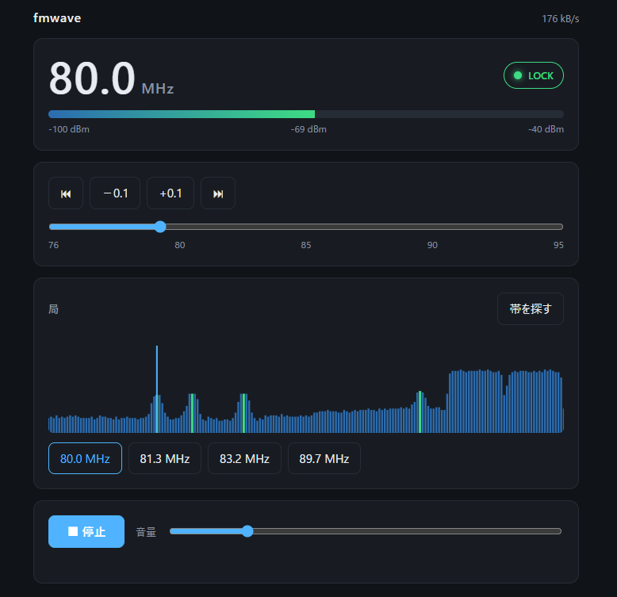

# fmwave

MyGica S270、PLEX PX-S1UDでFMラジオを受信し、`WAV`,`raw`で出力するプログラム。

ブラウザから放送局のスキャンや拝聴ができる簡易WebUIもあります。

```
fmwave -f 80.0 -t 10s -o fm.wav -v
```

## Web UI



```
fmwave -serve 127.0.0.1:8080
```

ブラウザーで開くと、周波数（±0.1 MHz・スライダー・局の間を跳ぶ）、ラジオ局のロック判定、
受信レベル、「帯を探す」（76〜95 MHz を 0.1 MHz 刻みでラジオ局をスキャンする機能）、再生と
音量。キーは ← → で 0.1 MHz、Space で再生・停止。音は `/pcm`（16 bit・2 ch・
44.1 kHz の生 PCM を流し続ける）を Web Audio で再生する。終了は Ctrl-C（`-t` を付けたときだけ、指定された時間経過で終了）。

## 使い方

使用には下記の手順でファームウェアファイルの準備とドライバ設定(Windowsのみ)が必要。

### ファームウェア

[MyGica のサポートページ](https://www.mygica.com/support/)から S270 のドライバー
（`S270_Driver.zip`）をダウンロードし、`S270 Driver/x64/x64Inf` にある `fm_radio_rio.inp` と
`isdbt_rio.inp` を、fmwaveバイナリと同じフォルダに `firmware`フォルダを作成し、ファームウェアを設置してください。

### WindowsのみWinUSBへの紐づけが必要

MacやLinuxでは不要。

WindowsのみMyGica S270、PLEX PX-S1UDをWinUSBドライバに紐づける必要。

`driver/windows` の `install-winusb.bat` に inf
（`s270-winusb.inf`）をドラッグすると、それを自前の証明書で署名して入れる（管理者の確認が一度
出る）。ダブルクリックすると、同一フォルダ内にある `*-winusb.inf` をインストールします。

アンインストールは`uninstall-winusb.bat`（ドラッグでもダブルクリックでも同じ形）。

## ライセンス

GPL-2.0-or-later
